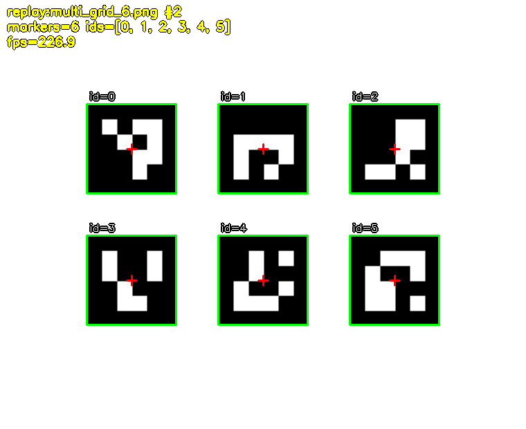

# up70-vision

UP70 战队视觉组仓库。目标是把 2D 视觉的基础链路跑通：**从图像输入到目标检出、绘制与落盘**，
为后续配合机械臂、接入 ROS 2 与激光融合打底。

仓库按层组织（算法 / 输入 / 可视化 / 编排），每层都能在没有相机、没有机器人的情况下几秒内验证。
当前承载两条主线：

| 主线 | 做什么 | 状态 |
|---|---|---|
| 判色链路 | HSV 判色 + 候选框筛选，给出色块的位置、颜色、命中率 | 已完成（M2 算法、M3 回归、M6 相机接入） |
| ArUco 识别 | 生成测试图 → 图片识别 → 摄像头实时识别 → 整合为单一入口 | 三连已完成 |

两条主线共用同一套输入源、可视化、配置与编排；检测器可替换（`blob` 判色 / `stub_aruco` 假码 / `aruco` 真码）。

---

## 当前状态

已完成：

| 模块 | 产出 |
|---|---|
| 判色（M2） | `core/color.py` + `core/pipeline.py`；合成图 3 帧 × 6 块 = 18 个色块，判色 18/18 |
| 回归测试（M3） | `tests/` 36 项：判色、几何、配置、类型 |
| 相机接入（M6） | `io/camera.py` 走海康 MVS SDK；曝光/增益可按场地调 |
| ArUco 生成与识别（任务一） | `core/detectors/aruco.py`（DICT_4X4_50）+ `tools/gen_aruco.py` + 9 张带真值图组 + 14 项测试 |
| 实时识别（任务二） | `cli.run_aruco_live()` + `scripts/run_aruco_live.py`：逐帧检测、绘制、窗口/落盘、终端节流 |
| 相机标定（尝试做 1） | `core/calibration.py`（内参 + 畸变 + 去畸变）+ `tools/calibrate_camera.py`（采图/解算）+ `tools/gen_chessboard.py`（造打印板）；见 `docs/相机标定.md` |
| 位姿估计（任务单第 2 条） | `core/pose.py`（`solvePnP` + 两条硬校验）+ `viz.draw_pose_axes` + 实时入口按码输出 `d/tilt/yaw`；11 项测试；见 `docs/位姿估计.md` |
| 识别效果测试（任务单第 3 条） | `tools/gen_pose_scenes.py`（带真值的合成图）+ `tools/pose_sweep.py`（七组单因素扫描、CSV/MD/PNG 报告） |
| 整合（任务三） | 两个入口共用 `cli.py`；检测器抽象为类；目录分层，不堆在一个文件里 |

未做（等外部条件确定，原因见 `docs/progress.md`）：ROS 2 对接（M4）、YOLO 接入（M5）、场地标定与阈值重调。

---

## 仓库提供什么

| 能力 | 位置 | 怎么验证 |
|---|---|---|
| ArUco 检测（DICT_4X4_50） | `core/detectors/aruco.py` | `python scripts/check_aruco.py` → 9/9 |
| ArUco 位姿估计（距离/倾角/面内角） | `core/pose.py` | `python scripts/pose_check.py --dir output/pose_scenes` |
| 位姿精度扫描（距离/倾角/光照/模糊） | `tools/pose_sweep.py` | `python scripts/pose_sweep.py` → CSV + MD + 8 张图 |
| ArUco 测试图组 | `assets/aruco/`（3 张单码 + 6 张场景 + 真值 JSON） | `python scripts/gen_aruco.py` 逐字节复现 |
| 实时循环（逐帧检测 + 绘制 + 落盘） | `cli.run_aruco_live()` / `scripts/run_aruco_live.py` | 见「最小示例」 |
| 批处理识别（读完汇总落盘） | `cli.run()` / `scripts/run.py` | `output/demo/` 下 4 种产物 |
| 判色（HSV + 命中率） | `core/color.py`、`core/pipeline.py` | 回归测试 + 批处理自检数字 |
| 输入源 | `io/`：synthetic / replay / camera | `--set input.source=...` |
| 配置系统 | `config/`：YAML + `--set` 点分覆盖 + 校验 | 写错字段启动即报错，返回 2 |
| 交互工具 | `tools/`：hsv_tuner、mvs_color_measure、gen_aruco、aruco_check | 各工具 `--help` |
| 回归测试 | `tests/`（73 项） | `for t in tests/test_*.py; do python "$t"; done` |

两种检出物分开定义，见 `docs/interface.md`：`Detection`（判色族，带颜色与命中率）与
`ArucoMarker`（码族，带 ID、四角、中心）。改契约要先改文档、再改实现。

---

## 开发环境约定

**统一用 Docker 提供环境**，不在本机装 conda / venv / 系统 Python 依赖。战队标准发行版是 Ubuntu 22.04，
镜像底座因此定为 `ubuntu:22.04`——它自带 Python 3.10，也是 ROS 2 Humble 唯一支持的发行版。

| 项 | 约定 |
|---|---|
| 环境提供方式 | Docker，镜像定义在 `.devcontainer/Dockerfile` |
| 底座 | `ubuntu:22.04` + 系统 Python 3.10 |
| Python 依赖 | 唯一真源是 `pyproject.toml`，镜像构建时安装（MVS SDK 例外，见「真相机」） |
| 换行 | LF，由 `.gitattributes` 与 `.editorconfig` 强制，不要手工改 |
| 图像顺序 | 一律 BGR（OpenCV 原生顺序），变量名带颜色空间后缀 |

OpenCV 需要的系统库（`libgl1` / `libglib2.0-0`）已在镜像里装好，本机不用单独装。

---

## 快速开始

```bash
# 1. 构建镜像（只需一次，约 2~3 分钟）
docker compose -f .devcontainer/docker-compose.yml build

# 2. 环境自检
docker compose -f .devcontainer/docker-compose.yml run --rm up70-vision python scripts/check_env.py

# 3. OpenCV 冒烟
docker compose -f .devcontainer/docker-compose.yml run --rm up70-vision python scripts/demo.py
```

第 2 步末行应是 `结果：全部通过`；第 3 步应看到：

```text
[自检] cv2 4.14.0 | numpy 2.2.6
[自检] 检出轮廓 1 个 | 叠加图已写出 output/demo/opencv_smoke.png
[自检] OpenCV 冒烟测试 -> PASS
```

退出码为 0，说明镜像里的依赖链完整、OpenCV 真的能跑。

下文命令都在容器内执行，容器外只需在命令前加：

```bash
docker compose -f .devcontainer/docker-compose.yml run --rm up70-vision
```

源码通过 bind mount 挂进容器：**改宿主机的代码在容器里立即生效**，只有改 `pyproject.toml`（增删依赖）才需要重新 `build`。
VS Code 用户可直接 Reopen in Container，配置在 `.devcontainer/devcontainer.json`。

> `scripts/demo.py` 故意写得又小、又不 import `up70_vision`——它是环境冒烟测试，不是业务实现，
> 避免和 `src/` 形成第二份「检测 → 判色」逻辑。

---

## 运行入口

两个入口都是薄壳，业务逻辑唯一实现在 `src/up70_vision/cli.py`——将来接 ROS 2 节点也复用同一个函数，
不会出现第二份「检测 → 绘制」流程。

| 入口 | 行为 | 产物 |
|---|---|---|
| `scripts/run.py` | 批处理：读完所有帧再汇总，不开窗口 | `output/demo/`：overlay、`results.json`、`detections.csv`、`summary.json` |
| `scripts/run_aruco_live.py` | 实时：逐帧检测并刷新画面，或按间隔落盘 | 窗口画面 / `output/aruco/frame_*.png` |

共用参数（两个入口语义一致）：

| 参数 | 含义 |
|---|---|
| `--config PATH` | 配置文件；默认 `configs/default.yaml`，其次环境变量 `UP70_CONFIG` |
| `--set a.b=c` | 按点分路径覆盖配置，可重复，**后写的生效**；只能改已存在的字段 |
| `--limit N` | 最多处理 N 帧；0 表示不限 |

实时入口额外两个参数：

| 参数 | 含义 |
|---|---|
| `--headless` | 不建窗口，改成每 `--save-every` 帧落盘（容器里没有 X server 时用） |
| `--save-every N` | headless 的落盘间隔，默认 30 帧；至少 1 |

实时循环的帧流程（顺序固定，**每帧重新检测**，不缓存上一帧的框）：

```text
read() 取一帧
  -> 量帧间隔，更新 fps 滑动平均（窗口 30 帧）
  -> detect(image_bgr)                返回 list[ArucoMarker]
  -> 画四边形 / 中心点 / ID 标签
  -> 画左上角 HUD（来源#帧号 / markers / fps）
  -> 窗口 imshow + waitKey(1)，或 headless 每 N 帧落盘
  -> frames += 1，本帧有码则 with_markers += 1
  -> 终端节流输出，--limit 到了就退出
```

终端输出规则：每 0.5 秒一行，**结果集变化（码增减 / ID 变化）立即补一行**；无码也打 `markers=0`，
这样"活着但没检测到"和"卡死了"在日志里能分清；不用 `\r` 原地刷新（重定向到文件会糊成一团）。

退出方式：

| 触发 | 说明 |
|---|---|
| 窗口按 `q` / `ESC` | 仅窗口模式；`waitKey(1)` 读到键 |
| 点窗口关闭按钮 | 检测窗口可见性，不会反复重建窗口 |
| `read()` 返回 None | 回放放完 / 相机到 `max_frames` |
| `--limit N` | 相机会无限出帧，靠它自己停 |
| `Ctrl+C` | `KeyboardInterrupt`，打印后正常收尾 |

退出码：`0` 正常跑完；`1` 一帧都没处理或落盘失败；`2` 配置 / 阈值表 / 检测器 / 输入源 / 窗口建不起来。
设备与窗口一律在 `finally` 里释放——相机是独占资源，异常路径不释放，下次必打不开。

---

## 常用命令

| 目的 | 命令（容器内执行） |
|---|---|
| 环境自检 | `python scripts/check_env.py` |
| OpenCV 冒烟 | `python scripts/demo.py` |
| ArUco 图组自检（9/9） | `python scripts/check_aruco.py` |
| 重新生成测试图组 | `python scripts/gen_aruco.py` |
| 造打印用棋盘板 | `python scripts/gen_chessboard.py --cols 9 --rows 6 --square-mm 15`（打印后要量实际边长） |
| 相机标定（采图 + 解算） | `python scripts/calibrate_camera.py --capture 15 --board 9x6 --square-mm 23`（**必填**，填尺子量到的实际值；本机标称 15 实测 23） |
| 批处理识别 | `python scripts/run.py --set detector.name=aruco --set input.source=replay --set input.replay.path=assets/aruco/scenes` |
| 回归测试（73 项） | `for t in tests/test_*.py; do python "$t"; done` |
| 看全部参数 | `python scripts/run.py --help` / `python scripts/run_aruco_live.py --help` |

---

## 目录导览

```text
up70_vision/
├── src/up70_vision/
│   ├── core/            纯算法层：判色、管线、数据结构
│   │   ├── detectors/   检测器：blob 判色 / stub_aruco 假码 / aruco 真码
│   │   ├── color.py     HSV 判色（H 0-179，红色两段阈值）
│   │   ├── pipeline.py  候选框 -> 命中率 -> Detection
│   │   └── types.py     Detection / ArucoMarker
│   ├── io/              输入源：synthetic / replay / camera（MVS）
│   ├── viz/             画框、HUD、落盘（PNG / JSON / CSV）
│   ├── config/          YAML 加载、字段校验、--set 覆盖
│   ├── utils/           图像读写、日志
│   ├── tools/           gen_aruco / aruco_check / hsv_tuner / mvs_color_measure
│   └── cli.py           唯一业务实现：run() 与 run_aruco_live()

├── scripts/             薄入口：run.py / run_aruco_live.py / demo.py / check_env.py
├── configs/             可调参数：default.yaml、color_thresholds.yaml
├── assets/              随仓库分发的素材
│   ├── aruco/           9 张测试图 + 真值 JSON
│   └── readme/          README 用的截图
├── tests/               回归测试 73 项，可 python tests/test_xxx.py 独立跑
├── docs/                进度 / 契约 / 三个规范 / ArUco 教程
├── .devcontainer/       Dockerfile、CPU/GPU compose、pkgs/
├── data/                数据集与回放素材（不进版本库）
└── output/              运行产物：demo/ 与 aruco/（不进版本库）
```

依赖方向是硬约束，下层不知道上层存在：

```text
utils ┐
      ├─> core ─> io ─> viz ─> cli ─> scripts/
config ┘
```

分层规则：

- `core/` 不 import ROS、不读文件、不开窗口——检测对不对，要能在没有相机、没有机器人的情况下几秒验出来。
- `io/` 只负责"给我下一帧"，不关心检测算法；相机是独占资源，`close()` 必须可靠。
- `viz/` 只画和写文件，不改检测结果。
- `scripts/` 保持薄入口，业务逻辑不落在脚本里。

---

## 最小示例：实时识别 ArUco

这是**验证仓库链路能跑通的最小例子**，不是仓库的全部能力：读一帧、找码、画框、终端报数，循环往复。

`assets/aruco/scenes/` 是 6 张带真值的场景图（多码、旋转、无码），把它当"视频流"喂进实时循环：

```bash
docker compose -f .devcontainer/docker-compose.yml run --rm up70-vision \
  python scripts/run_aruco_live.py \
  --set detector.name=aruco \
  --set input.source=replay \
  --set input.replay.path=assets/aruco/scenes \
  --headless --save-every 1
```

实际输出（节选）：

```text
检测器     : aruco {'dictionary': 'DICT_4X4_50', 'corner_refine': 'subpix', ...}
运行模式   : headless（落盘，不建窗口）
t=0.01s | frames=1 | fps=457.8 | markers=0
t=0.02s | frames=3 | fps=226.9 | markers=6 | id=0 center=(190.0, 215.0) | id=1 center=(380.0, 215.0) | ...
t=0.02s | frames=4 | fps=203.7 | markers=3 | id=0 center=(190.0, 260.0) | id=1 center=(380.0, 260.0) | ...
  帧数        : 6（有码 4 / 无码 2）
✅ 运行成功
```

叠加图落在 `output/aruco/frame_*.png`，例如 6 码场景：



> 绿框是四角，红叉是中心，左上 HUD 是来源 / 帧号 / fps / markers 列表。无码图输出 `markers=0` 而不是报错。

### 换成真摄像头

需要**原生机器 + 显示器**（容器里没有 X server 开不了窗口），并完成「真相机」三步前置：

```bash
docker compose -f .devcontainer/docker-compose.yml run --rm up70-vision \
  python scripts/run_aruco_live.py --set detector.name=aruco --set input.source=camera
```

窗口里按 `q` / `ESC` 退出，点关闭按钮也行；`Ctrl+C` 会正常收尾并释放相机。

### 没有相机、也想看"码在动"

用 stub 造假码（第一个码转圈 + 自转），跑 120 帧：

```bash
docker compose -f .devcontainer/docker-compose.yml run --rm up70-vision \
  python scripts/run_aruco_live.py \
  --set detector.name=stub_aruco --set input.synthetic.num_frames=120 \
  --headless --save-every 60
```

### 加上位姿：画面多三根轴，终端多三个数

需要两样东西：**相机内参**（`configs/camera_calibration.yaml`，标定产物、不进版本库）和
**码的实际边长**（卡尺量黑框外沿，不含白边）。

```bash
docker compose -f .devcontainer/docker-compose.yml run --rm up70-vision \
  python scripts/run_aruco_live.py \
  --set detector.name=aruco --set input.source=replay \
  --set input.replay.path=output/pose_scenes \
  --set pose.enabled=true --set pose.marker_size_mm=23 \
  --headless --limit 10
```

终端每行会多出三个字段：

```text
t=0.03s | frames=1 | fps=48.2 | markers=1 | id=0 center=(640.0, 512.0) d=452mm tilt=0.1 yaw=-0.0
```

- `d` 斜距（毫米）、`tilt` 码面与光轴夹角（0 = 正对）、`yaw` 面内转角
- 画面上红/绿/蓝三根轴是码的 x/y/z 方向；正视时蓝轴缩成一个点，这是对的
- 没有内参时位姿自动关闭并打一条警告（`calibration.required=false`），设成 `true` 则直接失败
- 精度扫描与失败归因：`python scripts/pose_sweep.py`，见 `docs/位姿估计.md`

---

## 配置

所有参数都在 `configs/default.yaml`，命令行用 `--set` 按点分路径覆盖，不用改文件：

```bash
--set detector.name=aruco            # blob / stub_aruco / aruco
--set detector.aruco.corner_refine=subpix   # none / subpix / contour
--set input.source=replay            # synthetic / replay / camera
--set input.replay.path=assets/aruco/scenes
--set input.camera.exposure_us=40000 # 相机曝光，微秒
--set pose.enabled=true              # 打开位姿估计（默认关闭）
--set pose.marker_size_mm=23         # 码边长，卡尺量黑框外沿
```

`--set` 只能改**已存在**的字段，名字写错会在启动时报错并返回 2，不会带着错配置继续跑。
启动时会把**实际生效**的配置整份打印一遍，日志和 PR 里能直接看到覆盖结果，不用回头翻命令行。

YAML 的顶层块：

| 块 | 内容 |
|---|---|
| `input` | 输入源选择与各源参数（synthetic 的尺寸/帧数，replay 的路径/步长，camera 的曝光/增益） |
| `color` | 判色参数：饱和度/亮度下限、命中率门槛、忽略边框像素、阈值表路径 |
| `detector` | 检测器选择与各检测器参数（blob / stub_aruco / aruco） |
| `calibration` | 内参文件位置（相对 `configs/`）与"缺失时是否硬失败" |
| `pose` | 位姿开关、码边长、求解方法、重投影门槛 |
| `output` / `log` | 落盘开关与目录、日志等级 |

相机曝光是最需要按场地重调的参数（本机实测）：20 ms 太暗、80 ms + 10 dB 合适、200 ms 过曝；
手举码晃动时建议降到 40 ms——80 ms 下码在曝光期内移动约 20 px，4x4 的单格会糊掉而丢码。

---

## 真相机 / GPU / pip 源

真相机（海康 MV-CU013-A0UC）走 **USB3 Vision（GenICam），不是 UVC**：宿主机不会出现 `/dev/video*`，
`cv2.VideoCapture` 打不开它，也没有"把用户加进 `video` 组"这回事。三步，缺一步都打不开，且报错不会提示原因：

1. 宿主机 udev 给 USB 权限（容器里改不了）：`/etc/udev/rules.d/99-hikrobot.rules` 写
   `SUBSYSTEM=="usb", ATTRS{idVendor}=="2bdf", MODE="0666", SYMLINK+="hik_camera"`，
   然后 `sudo udevadm control --reload-rules && sudo udevadm trigger`，再重新插拔相机。
2. 把 MVS 的 deb 放进 `.devcontainer/pkgs/` 并重新 `build` 镜像（deb 写不进 `pyproject.toml`）。
3. compose 已配 `devices: ["/dev/bus/usb:/dev/bus/usb"]`——透传的是 USB 总线，不是 `/dev/video0`。

相机是**独占资源**：MVS 客户端、调参窗口、本仓库的 `camera` 源三者互斥，打不开先关掉别的占用者。

**GPU 机器**：`.devcontainer/docker-compose-gpu.yml` 在 CPU 版基础上透传 NVIDIA GPU。
当前没有 CUDA 依赖，它是预留；等接 YOLO 训练、镜像里装 cu128 的 torch 时才用得到。
宿主机需先装 NVIDIA 驱动与 `nvidia-container-toolkit`：

```bash
docker compose -f .devcontainer/docker-compose-gpu.yml run --rm up70-vision python scripts/demo.py
```

**pip 源**：镜像构建默认用阿里云源（国内快）；太慢或报 `Could not find a version that satisfies the requirement`
时用 build-arg 换源，不用改 Dockerfile：

```bash
docker compose -f .devcontainer/docker-compose.yml build --build-arg PIP_INDEX_URL=https://mirrors.ustc.edu.cn/pypi/simple
```

**为什么是 Python 3.10**：未来视觉得跑在 ROS 2 Humble 的容器里，Humble 官方只支持 Ubuntu 22.04，
其自带 Python 3.10。开发环境跟部署环境对齐，能避免"本地跑得好好的、一进容器就报语法错"。
因此仓库代码不使用 3.11+ 的专属语法，`requires-python` 下限保持在 3.10。

---

## 测试与自检

| 项 | 命令 | 期望 |
|---|---|---|
| 环境 | `python scripts/check_env.py` | 末行「结果：全部通过」 |
| OpenCV 冒烟 | `python scripts/demo.py` | `OpenCV 冒烟测试 -> PASS` |
| ArUco 图组 | `python scripts/check_aruco.py` | `通过 9/9`，中心误差 0.00 px，四角 ≤ 0.23 px |
| 回归测试 | `for t in tests/test_*.py; do python "$t"; done` | **73 项**全过（判色/几何/配置 36 + ArUco 14 + 标定 9 + 位姿 11）；Windows 上 `test_config` 有 1 项路径断言按 POSIX 写，会失败 |

几个约定：

- 镜像里没有 pytest，`tests/` 下每个文件都能用 `python` 直接跑（内置独立运行器）。
- 断言必须带具体数字（如 `18/18`、`≤ 0.23 px`），不写 `assert x > 0`——判色错了不抛异常，只会"看起来不太准"。
- 宿主机 apt 版 OpenCV 4.5.4 没有新版 `aruco` API，`test_aruco.py` 在宿主机上会自动跳过；以容器结果为准。
- 图组真值在 `assets/aruco/`，改了生成器就用 `gen_aruco.py` 重新生成（同参数重跑逐字节一致）。

---

## 文档

| 文件 | 内容 |
|---|---|
| `docs/progress.md` | 进度、实测数字、踩过的坑 |
| `docs/interface.md` | 接口契约（`Frame` / `ArucoMarker` / `detect()` 签名） |
| `docs/代码注释规范.md` | 注释与 docstring 写到什么程度 |
| `docs/提交信息规范.md` | git 提交信息怎么写 |
| `docs/视觉组协作规范.md` | 分支命名、自审、squash 合并与合并后冒烟 |
| `docs/ArUco码原理与识别教程.md` | ArUco 编码方式、字典与 ID 的入门材料 |
| `docs/相机标定.md` | 内参与畸变怎么标、怎么读、填错会怎样 |
| `docs/位姿估计.md` | PnP 口径、实测精度表、失败排查与已知坑 |

---

## 团队约定

- 改 `src/` 前先跑 `check_env.py` 与 `demo.py`，两个都通过再提交；有算法改动加跑 73 项回归：

  ```bash
  for t in tests/test_*.py; do python "$t"; done
  ```

- 碰 ArUco 相关代码后跑 `check_aruco.py`，期望 `通过 9/9`、四角误差 ≤ 0.25 px。
- 碰位姿相关代码后加跑 `pose_check.py`，真机口径图组期望 `通过 28/31`（失败项固定是 `blur_09`、`blur_13`、`bright_300` 三个已知边界）：
  `python scripts/gen_pose_scenes.py --suite --marker-mm 23 --calib configs/camera_calibration.yaml --out output/pose_scenes` 然后
  `python scripts/pose_check.py --dir output/pose_scenes --intrinsics configs/camera_calibration.yaml --marker-mm 23`。
- 命名：模块/函数/变量小写下划线，类大驼峰，常量全大写；图像变量必须带颜色空间后缀（`frame_bgr`）。
- 注释按 `docs/代码注释规范.md`：模块/类/函数都要 docstring，写「为什么、边界、症状」，不复述代码。
- 提交按 `docs/提交信息规范.md`，分支与自审按 `docs/视觉组协作规范.md`；`main` 始终可运行。
- 图像一律按 OpenCV 的 BGR 顺序处理；检测框用绝对像素坐标，右/下边界为开区间（半开上界）。
- 新增算法要配「断言带具体数字」的验证，不要写 `assert x > 0`。
- 判色的分母是「有效像素」（饱和度/亮度达标的像素），不是 ROI 总像素——否则背景会稀释命中率。
- HSV 的 H 范围是 0-179，不是 0-360；红色必须写两段阈值（`[0,10]` 与 `[170,179]`）再取并集。
- `core/` 不 import ROS、不读文件、不开窗口；`scripts/` 保持薄入口。
- 图上一律用 ASCII 英文：`cv2.putText` 的 Hershey 字体不含汉字字形，传中文会画问号而且不报错。
- 权重（`*.pt` / `*.onnx`）、数据集、rosbag 一律不进 git，规则见 `.gitignore`。

---

## 已知限制

- **位姿精度只在合成图上验过**：`docs/位姿估计.md` 的实测表来自合成图（无镜头畸变、理想边缘），属识别能力上限；真机抽测要等内参与实测边长到位。
- **位姿只做单码相对位姿**：多码融合、场地坐标系下的绝对位姿都没做（需要 ID→场地坐标的对应表）。
- **容器里没有窗口**：实时验证走 `--headless` 落盘；窗口模式在原生机器上验。
- **相机需要 MVS SDK**：镜像不带 deb，需手动投放后重新构建；没有相机时用 `replay` 或 `stub_aruco`。
- **YOLO 未接入**：`blob` 判色是占位，检测器接口已按可替换设计（`core/detectors/base.py`）。
- **ROS 2 未接入**：入口已按「薄壳 + 单一实现」设计，节点接入时复用 `cli.py`。
- **判色阈值依赖光照**：换场地要重调 `color_thresholds.yaml`，`hsv_tuner.py` 是为此准备的。
