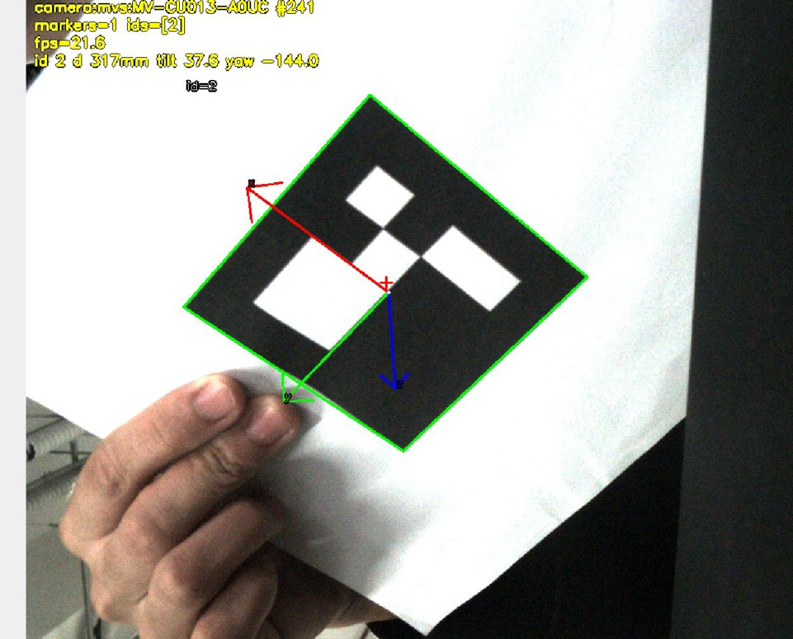

# UP70 视觉

本仓库提供 **YOLO + RGB-D 可见平面候选**作为当前整机联调入口，同时保留海康相机的 ArUco、YOLO、HSV 判色与离线验证工具。

当前融合流程为：Orbbec Gemini 336L 彩深图 → 时间配对和网格校正 → YOLO 检测框 → 框内平面拟合 → ROS 2 候选话题和 RViz。输出是**可见平面内点重心及朝相机的法向候选**，还不是机械臂基座坐标或已验证抓取点。空间对齐、绝对定位精度和连续稳定性尚未完成验收；详见 [整机联调说明](knowledge/docs/整机联调说明.md)。

## RGB-D 融合：运行入口

比赛目标 ROS 2 Humble 的独立 Docker 环境及海康/Gemini 使用方法见 [Humble 容器说明](.devcontainer/README-humble.md)；真机与跨机验证状态以该说明和深度进度为准。

当前已验证运行环境是本机 ROS 2 Jazzy、Orbbec ROS wrapper/SDK 2.9.3 和 OpenCV ≥4.10。先从搭档处取得 `yolov8n_mix4.onnx` 与同名 `.names.json` 放入 `knowledge/models/`：两者不随 Git 分发，模型为 CPU 推理，类别是 `block`、`top`。设备准备、依赖、配置和限制见 [联调说明](knowledge/docs/整机联调说明.md)。

从仓库根目录运行，确保 ROS、Orbbec 驱动和带项目依赖的 Python 环境已就绪：

```bash
source /opt/ros/jazzy/setup.bash
source ~/.venvs/up70-rgbd/bin/activate  # 示例；使用自己的 ROS 兼容 Python 环境
cd ros2_ws
python -m colcon build --packages-select vision_depth --symlink-install
source install/setup.bash
cd ..
export ROS_DOMAIN_ID=97  # 示例；同一联调组保持一致
ros2 launch vision_depth rgbd_side_viewer.launch.py rviz:=true
```

相机启动后，`/rgbd_side/candidates` 发布候选重心、类别和法向姿态，`/rgbd_side/markers` 供 RViz 显示。话题单位、时间戳、有效期与四元数含义见 [接口契约](vision/docs/interface.md#rgb-d-可见平面候选输出2026-11-02)。

**当前 launch 强制使用 Fast DDS 仅共享内存配置，只适用于同机通信。** 其他机器无法直接发现或订阅该配置下的节点；跨机部署方案尚未确定。只想使用已有相机或回放时，传 `start_camera:=false`，并提供匹配的对齐彩深图和 CameraInfo。

---

## 2D 与通用工具：容器快速开始

```bash
# 只需一次：构建镜像（约 2~3 分钟）
docker compose -f .devcontainer/docker-compose.yml build

# 三条自检，依次应看到「全部通过」「PASS」「✅ 运行成功」
docker compose -f .devcontainer/docker-compose.yml run --rm up70-vision python -m vision doctor
docker compose -f .devcontainer/docker-compose.yml run --rm up70-vision python -m vision demo
docker compose -f .devcontainer/docker-compose.yml run --rm up70-vision python -m vision run
```

`./demo.sh` 把这三步串起来，跑完 `output/demo/` 里有叠加图 + JSON + CSV。
源码是 bind mount，改代码立即生效；只有改 `pyproject.toml` 才需要重新 build。

---

## 2D 命令与离线工具

**只有 6 条主入口**：`python -m vision [run|live|doctor|demo|hsv-tuner|clean]`
（不带参数会打印这张表）。其余一次性工具在 `lab/`，直接 `python lab/xxx.py`。

```bash
# 实时 ArUco（窗口；无显示器加 --headless --save-every 30 --limit 300）
python -m vision live --set detector.name=aruco --set input.source=camera --set input.camera.exposure_us=40000

# 加位姿：画面多三根坐标轴；窗口 HUD 第 4 行直接显示 d/tilt/yaw（终端也同步打）
python -m vision live --set detector.name=aruco --set input.source=camera \
  --set pose.enabled=true --set pose.marker_size_mm=84

# 实时 YOLO（2 类：block/top）+ HSV 判色；窗口卡就加 --max-fps 4~6
python -m vision live --set detector.name=yolo \
  --set detector.yolo.weights=knowledge/models/yolov8n_mix4.onnx \
  --set input.source=camera --set input.camera.exposure_us=20000 --max-fps 5

# 批处理（读完再汇总）：判色 18 块 / ArUco / YOLO
python -m vision run --set input.source=synthetic
python -m vision run --set detector.name=yolo --set input.source=replay --set input.replay.path=<图片目录>

# 造合成的 YOLO 训练集（350 mm 方块 / 200 mm 半红半蓝塔顶，自动标注）
python lab/gen_yolo_dataset.py --out data/yolo_synth --num 300

# 补实拍数据：开窗口给人摆位，每 1 秒存一张（远景/遮挡/空场景负样本都用它）
python lab/capture_dataset.py --tag g6_far --exposure-us 20000 --interval 1.0
python lab/capture_dataset.py --tag neg --exposure-us 10000 --frames 30   # 拍 30 张自动停

# 常用自检：ArUco 图组 9/9、位姿逐图、相机标定
python lab/check_aruco.py
python -m lab.pose_check --dir <图组目录>          # 或 --sweep 做七组精度扫描
python lab/calibrate_camera.py --capture 15 --board 9x6 --square-mm 23
```

在别的代码里用一次检测：`from vision.api import detect; detect(img, "aruco")`。

参数都在 `configs/default.yaml`（判色阈值在 `configs/color_thresholds.yaml`），
`--set 点分路径=值` 临时覆盖，只能改已存在的字段，写错启动即报错。

上面的 2D 通用容器不包含 ROS 2，不能直接运行 RGB-D 融合入口。



---

## 目录结构

```
vision/        运行时代码（要 import / 要测 / 有架构约束）
├── __main__.py  进程入口：python -m vision <子命令>
├── api.py       库门面：detect(image_bgr, detector)
├── types.py     唯一共用件：Frame / Detection / 几何
├── cli/         命令适配层：parsers / run / live / output
├── config/      YAML 加载、字段校验、--set 覆盖
├── sources/     输入源：camera / replay / synthetic（+ read_image_bgr）
├── aruco/       功能包：detector / pose / calibration / draw / types / stub
├── yolo/        功能包：detector / candidates / color_check / pipeline / draw
└── depth/       深度相机算法（纯 Python，可 pytest；ROS 外壳在 ros2_ws/）

ros2_ws/       ROS 2 工作空间（包含 RGB-D 融合与纯深度适配）
lab/           一次性工具：check_aruco / pose_check / calibrate / gen_*（零架构约束，可互相 import）
configs/       场地参数；knowledge/ docs·calibration·models·images；tests/ 回归测试与夹具
```

依赖方向是硬约束：**功能包互不 import，功能包不碰 cli/config，`vision/` 不 import `lab/`**
（`tests/test_architecture.py` 会检查）。`lab/` 可以 import `vision/`，反之不行。

---

## 一定会踩的坑

1. **相机不是 UVC**：海康 MV-CU013-A0UC 走 USB3 Vision，宿主机没有 `/dev/video*`，`cv2.VideoCapture`
   打不开且不提示原因。三步缺一不可：udev 规则给权限（`idVendor=2bdf`）、把 MVS 的 deb 放进
   `.devcontainer/pkgs/` 后**重新 build**、compose 透传 `/dev/bus/usb`。
2. **相机是独占资源**：MVS 客户端、调参窗口、本仓库互斥，打不开先关占用者。
3. **容器里开窗口**要三件事：`xhost +local:root`、`-e DISPLAY=$DISPLAY`、挂 `/tmp/.X11-unix`；
   旧镜像会报 `xcb` 加载失败——镜像需含 `libsm6 libice6`，旧的重新 build。
4. **别装 `opencv-contrib-python` / `-headless`**：三者顶层模块都叫 `cv2`，互相覆盖且不报错。
5. **尺寸别混**：棋盘格 `--square-mm 23`（标称 15、实量 23）、ArUco 码 `pose.marker_size_mm`（实测黑框外沿，
   我们那批是 84 mm）。填错**不会让重投影误差变大**，只会让距离按比例错——用手机屏幕显示码时，
   填的是**屏幕上量到的实际尺寸**，不是文件里的设计值。
6. **位姿正视附近 `tilt` 不可信**（0° 附近可散到 10°+，倾斜 15° 以上才准）。
7. **曝光必须按场景调**：同一台相机在不同光照下要 3 ms ~ 40 ms 之间换（差 13 倍）。过曝会让白格并成一片、
   角点外扩，`d` 系统性偏大（实测偏 5%）；先用 3/10/20/40 ms 各拍一张，白格灰度 <250 再开跑。
8. **码必须贴平**：纸一弯（手捏着拍）平面假设就失效，重投影 RMS 会从 0.4 跳到 2.2 px，位姿被硬校验拒绝。
   用硬板/手机屏幕，四边都贴住。
9. **生成物不进版本库**：`output/`（运行产物）、`data/`（数据集）、`runs/`（训练产物）、
   `knowledge/models/*.onnx`、`configs/camera_calibration*.yaml` 都被 gitignore。
   新 clone 要位姿就先自己标定。2D 模型可按训练记录导出；RGB-D 当前默认使用搭档提供的 640 输入 mix4，
   不要把其他尺寸或预训练权重当成同一模型。
10. **镜像里没有 pytest**：完整回归应使用安装了 pytest 的隔离副本；避免在原工作区运行会重建 `output/` 的测试。
11. **`live` 现在支持三种检测器**：ArUco 画四边形+位姿轴；判色/YOLO 画框并显示
    `类别/颜色 置信度`（`top` 按上半块判色，框固定品红，所以红塔顶也会是品红框）。
    落盘目录也分开：ArUco 在 `output/aruco/`，判色/YOLO 在 `output/live_det/`。
12. **窗口卡退先降 `--max-fps`**：YOLO 在 CPU 上单帧约 40 ms（640 输入），相机 20 fps 追着跑会把 CPU
    吃满、窗口事件循环抢不到时间片，表现就是"未响应/点一下就没"。`--max-fps 4~6` 对 ArUco 与
    判色/YOLO 两条实时循环都生效；还想更快就导 480 的 ONNX（见坑 9），CPU 能空出一半。

---

## 已知限制

- 2D 位姿历史样本的位移差分误差 ≤0.2%（200/400 mm）；30°、50° 软纸样本平面度存疑。仍只有单码相对位姿，绝对距离比较受测量基准影响；具体条件见真机记录。
- ROS 2 融合外壳复用 YOLO 与深度算法；独立 2D 库本身不依赖 ROS。当前未发布已验证的机械臂抓取指令。
- YOLO 是**真图训练的 2 类模型**（`block`/`top`）。v2 同分布指标 P 0.971 / R 0.939 / mAP@0.5 0.970，
  但 test 里有相邻帧跨 train（max 0.971），**不能当泛化指标**。
  **v3 无泄漏划分上：基线 mAP50 0.850 → 90° 旋转增广 `v3_aug2` 0.885**
  （test = g3tilt + g4stack，52 图/173 框；P 0.912 / R 0.806，类别错 18→6）。
  剩余问题：FP 3→13、叠放合并 15 基本没动。颜色仍由 HSV 判，距离不归 2D（交给深度相机）。
  详见 `knowledge/docs/YOLO训练与评测记录.md`、`knowledge/docs/YOLO2D数据泄漏与尺寸歧义.md`。
- 判色阈值依赖光照，换场地要重调（`hsv-tuner` 就是干这个的）。

---

## 文档去哪看

- **文档索引**（该先读哪篇、哪篇是存档）：[`knowledge/docs/README.md`](knowledge/docs/README.md)
- **契约**（`Frame` / `Detection` / `ArucoMarker` / `MarkerPose` 的唯一来源）：[`vision/docs/interface.md`](vision/docs/interface.md)
- **写代码前**：[`knowledge/docs/视觉组协作规范.md`](knowledge/docs/视觉组协作规范.md) 与 [`代码注释规范`](knowledge/docs/代码注释规范.md)
- **位姿真机数据与坑**：[`knowledge/docs/位姿估计真机测试计划.md`](knowledge/docs/位姿估计真机测试计划.md)（8.1–8.5 实测记录 + 15 条真机坑）
