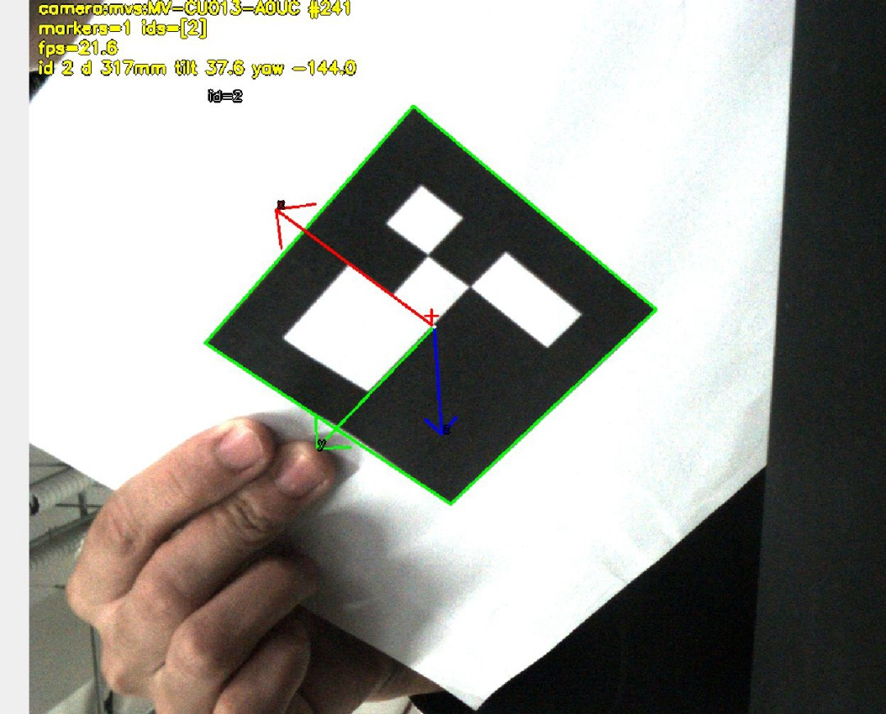

# up70-vision

UP70 战队视觉组仓库：把 2D 视觉链路跑通，**从图像输入到目标检出、位姿、绘制与落盘**，
为机械臂与 ROS 2 打底。两条主线共用同一套输入源、可视化、配置与编排：

| 主线 | 做什么 | 状态 |
|---|---|---|
| 判色 | HSV 判色 + 候选框筛选，给出色块位置、颜色、命中率 | 已完成 |
| ArUco | 检测 → 位姿（距离/倾角/面内角）→ 实时循环 → 精度扫描 | 已完成（合成图验收，真机待补） |

---

## 当前状态

| 模块 | 产出 |
|---|---|
| 判色 | `core/color.py` + `core/pipeline.py`；合成图 18 个色块，判色 18/18 |
| ArUco 检测 | `core/detectors/aruco.py`（DICT_4X4_50）+ `tools/gen_aruco.py` + 9 张带真值图组 |
| 位姿估计 | `core/pose.py`（`solvePnP` + 两条硬校验）+ `viz.draw_pose_axes`；13 项测试 |
| 识别效果测试 | `tools/gen_pose_scenes.py`（带真值合成图）+ `tools/pose_check.py --sweep`（七组单因素扫描） |
| 实时循环 | `cli.run_aruco_live()` + `scripts/run_aruco_live.py`：逐帧检测、画轴、终端与 HUD 报数 |
| 相机标定 | `core/calibration.py` + `tools/calibrate_camera.py` + `tools/gen_chessboard.py`（PNG/PDF 1:1） |
| 输入源 | `io/`：synthetic / replay / camera（海康 MVS SDK） |

未做：ROS 2 对接、YOLO 接入、场地标定与阈值重调（原因见 `docs/progress.md`）。

---

## 仓库提供什么

| 能力 | 位置 | 怎么验证 |
|---|---|---|
| ArUco 检测 | `core/detectors/aruco.py` | `python scripts/check_aruco.py` → 9/9 |
| 位姿估计（距离/倾角/面内角） | `core/pose.py` | `python scripts/pose_check.py --dir output/pose_scenes_825 --marker-mm 82.5` → 29/31 |
| 位姿精度扫描 | `tools/pose_check.py --sweep` | `python scripts/pose_check.py --sweep --marker-mm 82.5` → CSV + MD + 8 张图 |
| 实时循环 | `cli.run_aruco_live()` | 见「最小示例」 |
| 判色 / 批处理 | `core/color.py`、`cli.run()` | `python scripts/run.py` → `output/demo/` 4 种产物 |
| YOLO 检测器（可选） | `core/detectors/yolo.py`（ONNX + `cv2.dnn`，不需 torch） | 先生成权重：`python scripts/export_yolo.py --weights yolov8n.pt`；再 `--set detector.name=yolo` |
| 回归测试 | `tests/`（98 项） | `for t in tests/test_*.py; do python "$t"; done` |

两种检出物分开定义，见 `docs/interface.md`：`Detection`（判色族）与 `ArucoMarker`（码族）。
改契约要先改文档、再改实现。

---

## 开发环境

统一用 Docker，不在本机装依赖。镜像底座 `ubuntu:22.04` + Python 3.10（对齐 ROS 2 Humble）。

```bash
# 1) 构建镜像（只需一次，约 2~3 分钟）
docker compose -f .devcontainer/docker-compose.yml build

# 2) 环境自检：末行应是「结果：全部通过」
docker compose -f .devcontainer/docker-compose.yml run --rm up70-vision python scripts/check_env.py

# 3) OpenCV 冒烟：应看到「OpenCV 冒烟测试 -> PASS」
docker compose -f .devcontainer/docker-compose.yml run --rm up70-vision python scripts/demo.py
```

下文命令都在容器内执行，容器外只需加前缀：

```bash
docker compose -f .devcontainer/docker-compose.yml run --rm up70-vision
```

源码是 bind mount，改宿主机代码立即生效；只有改 `pyproject.toml` 才需要重新 build。
容器里**可以开窗口**（需要 `xhost +local:root`、`-e DISPLAY`、挂 `/tmp/.X11-unix`，
镜像含 `libsm6 libice6`）；没有显示器就加 `--headless` 落盘。

---

## 目录导览

```text
up70_vision/
├── src/up70_vision/
│   ├── core/            纯算法层：判色、管线、位姿、标定、数据结构
│   │   ├── detectors/   blob 判色 / stub_aruco 假码 / aruco 真码
│   │   ├── pose.py      solvePnP + 两条硬校验（重投影 RMS、z 前向性）
│   │   ├── calibration.py 内参、去畸变、按分辨率等比缩放
│   │   └── types.py     Detection / ArucoMarker / MarkerPose
│   ├── io/              输入源：synthetic / replay / camera（MVS）
│   ├── viz/             画框、坐标轴、HUD、落盘（PNG / JSON / CSV）
│   ├── config/          YAML 加载、字段校验、--set 覆盖
│   ├── tools/           生成与自检：gen_*、*_check、hsv_tuner
│   └── cli.py           唯一业务实现：run() 与 run_aruco_live()
├── scripts/             薄入口，只转交 argv
├── configs/             default.yaml、color_thresholds.yaml、默认内参快照
├── assets/              aruco/（9 张图 + 真值）、calib/（棋盘 PNG+PDF）、readme/（截图）
├── tests/               回归测试 98 项，可 python tests/test_xxx.py 独立跑
├── docs/                进度 / 契约 / 三个规范 / ArUco 教程 / 标定、位姿与 YOLO 说明
├── .devcontainer/       Dockerfile、CPU/GPU compose、pkgs/
├── data/                数据集与回放素材（不进版本库）
└── output/              运行产物：demo/、aruco/、pose_scenes*/、pose_sweep/（不进版本库）
```

依赖方向是硬约束，下层不知道上层存在：`utils/config → core → io → viz → cli → scripts/`。
`core/` 不 import ROS、不读文件、不开窗口；`scripts/` 保持薄入口。

---

## 常用命令

| 目的 | 命令（容器内执行） |
|---|---|
| 环境自检 / 冒烟 | `python scripts/check_env.py` / `python scripts/demo.py` |
| ArUco 图组自检 | `python scripts/check_aruco.py` → 9/9 |
| 造打印用棋盘板 | `python scripts/gen_chessboard.py --cols 9 --rows 6 --square-mm 15`（出 PNG+PDF，打印用 PDF、选「实际大小」） |
| 相机标定 | `python scripts/calibrate_camera.py --capture 15 --board 9x6 --square-mm 23`（**必填**，填量到的格子边长） |
| 位姿逐张核对 | `python scripts/pose_check.py --dir output/pose_scenes_825 --intrinsics configs/camera_calibration.yaml --marker-mm 82.5` |
| 位姿精度扫描 | `python scripts/pose_check.py --sweep --marker-mm 82.5 --intrinsics configs/camera_calibration.yaml --out output/pose_sweep/20261019_825` |
| 回归测试 | `for t in tests/test_*.py; do python "$t"; done` |

---

## 最小示例：从识别到位姿

一条主线：读帧 → 找码 → 画框 → 解位姿 → 终端与画面报数。中间只差两个参数：
`--set pose.enabled=true --set pose.marker_size_mm=82.5`。

**识别**：把 `assets/aruco/scenes/` 的 6 张场景图当视频流喂进实时循环：

```bash
docker compose -f .devcontainer/docker-compose.yml run --rm up70-vision \
  python scripts/run_aruco_live.py \
  --set detector.name=aruco --set input.source=replay \
  --set input.replay.path=assets/aruco/scenes \
  --headless --save-every 1
```

期望 `帧数 6（有码 4 / 无码 2）`；无码图输出 `markers=0` 而不是报错。

**位姿**：需要相机内参与**码的实际边长**（卡尺量黑框外沿；本批 **82.5 mm**）：

```bash
docker compose -f .devcontainer/docker-compose.yml run --rm up70-vision \
  python scripts/run_aruco_live.py \
  --set detector.name=aruco --set input.source=replay \
  --set input.replay.path=output/pose_scenes_825 \
  --set pose.enabled=true --set pose.marker_size_mm=82.5 \
  --headless --limit 10
```

终端每行多三个字段，画面左上角 HUD 也多一行同样的数字：

```text
t=0.03s | frames=1 | fps=48.2 | markers=1 | id=0 center=(642.3, 532.5) d=451mm tilt=0.4 yaw=0.0
id 0 d 451mm tilt 0.4 yaw 0.0
```

- `d` 斜距（毫米）、`tilt` 码面与光轴夹角（0 = 正对）、`yaw` 面内转角
- 红/绿/蓝三根轴是码的 x/y/z 方向；正视时蓝轴缩成一个点，这是对的
- 没有内参时位姿自动关闭并打警告；`calibration.required=true` 则直接失败

真机实拍（82.5 mm 码，40 ms / 15 dB）：绿框是四角，三根轴贴在码面上，HUD 第四行是这一帧的
`d/tilt/yaw`。图中 `d=317mm tilt=37.6 yaw=-144.0`。



**换真相机**（接好相机 + 有显示器）：

```bash
xhost +local:root
docker compose -f .devcontainer/docker-compose.yml run --rm \
  -e DISPLAY=$DISPLAY -v /tmp/.X11-unix:/tmp/.X11-unix up70-vision \
  python scripts/run_aruco_live.py --set detector.name=aruco --set input.source=camera \
  --set pose.enabled=true --set pose.marker_size_mm=82.5 \
  --set input.camera.exposure_us=40000 --set input.camera.gain_db=15
```

窗口里按 `q` / `ESC` 退出。没有相机时用 `stub_aruco` 造假码：

```bash
docker compose -f .devcontainer/docker-compose.yml run --rm up70-vision \
  python scripts/run_aruco_live.py --set detector.name=stub_aruco \
  --set input.synthetic.num_frames=120 --headless --save-every 60
```

### 完整例程：识别 → 位姿（五条命令）

```bash
# 1) 识别自检：9 张真值图，期望 9/9
python scripts/check_aruco.py

# 2) 造带真值的合成图（31 个场景，用真机内参与实测边长）
python scripts/gen_pose_scenes.py --suite --marker-mm 82.5 \
  --calib configs/camera_calibration.yaml --out output/pose_scenes_825

# 3) 逐张核位姿：期望通过 29/31（已知边界是 bright_300 与 blur_13）
python scripts/pose_check.py --dir output/pose_scenes_825 \
  --intrinsics configs/camera_calibration.yaml --marker-mm 82.5

# 4) 实时：终端与 HUD 同时出 d / tilt / yaw
python scripts/run_aruco_live.py --set detector.name=aruco \
  --set input.source=replay --set input.replay.path=output/pose_scenes_825 \
  --set pose.enabled=true --set pose.marker_size_mm=82.5 --headless --limit 10

# 5) 精度扫描：raw.csv + summary.md + 8 张曲线图
python scripts/pose_check.py --sweep --marker-mm 82.5 \
  --intrinsics configs/camera_calibration.yaml --out output/pose_sweep/20261019_825
```

82.5 mm 码的合成基线（fx=1321.67）：距离误差 **0.02%–0.42%**，倾角 15°–75° 误差 **0.05–0.42°**。
真机要先解决光照：40 ms 下画面均值低于 30 时角点会飘，`estimate_pose` 会因 RMS 超限拒绝出解。

---

## 配置

参数都在 `configs/default.yaml`，命令行用 `--set` 按点分路径覆盖；只能改已存在的字段，
名字写错启动即报错（返回 2）。启动时会把实际生效的配置整份打印一遍。

```bash
--set detector.name=aruco            # blob / stub_aruco / aruco
--set input.source=replay            # synthetic / replay / camera
--set input.camera.exposure_us=40000 # 相机曝光，微秒
--set pose.enabled=true              # 打开位姿估计（默认关闭）
--set pose.marker_size_mm=82.5       # 码边长，卡尺量黑框外沿
```

**两个尺寸别混**（都"不报错只让数字错"）：

| 尺寸 | 值 | 用在哪 |
|---|---|---|
| 棋盘格方格边长 | **23 mm** | 相机标定 `--square-mm`；填错内参整体错 |
| ArUco 码边长 | **82.5 mm** | 位姿 `pose.marker_size_mm` / `--marker-mm`；填错距离按比例错 |

`pose.marker_size_mm` 默认仍是 **23.0**（上一批码的历史值），用 82.5 mm 的码必须显式传，
否则距离会偏到 0.279 倍。

**内参**：`configs/camera_calibration.yaml` 在 `.gitignore` 里，但仓库**强制带了一份默认快照**
（本机 2026-10-19 标定，33 视图，RMS 0.473 px，1280×1024，fx≈1321.67），新 clone 位姿可直接跑。
重标定会覆盖同一路径——提交前确认是不是全队约定的那台相机；只用别人的标定就 `--intrinsics` 指定。

相机曝光按场地重调：动目标 **40 ms**（80 ms 下码在曝光期内移动约 20 px，单格会糊）；
照度不够优先加光/开大光圈，不要靠拉长曝光。

---

## 真相机

海康 MV-CU013-A0UC 走 **USB3 Vision（GenICam），不是 UVC**：宿主机没有 `/dev/video*`，
`cv2.VideoCapture` 打不开。三步缺一不可，且报错不会提示原因：

1. 宿主机 udev 给权限（容器里改不了）：`/etc/udev/rules.d/99-hikrobot.rules` 写
   `SUBSYSTEM=="usb", ATTRS{idVendor}=="2bdf", MODE="0666", SYMLINK+="hik_camera"`，
   然后 `sudo udevadm control --reload-rules && sudo udevadm trigger`，再拔插相机。
2. 把 MVS 的 deb 放进 `.devcontainer/pkgs/` 并重新 `build` 镜像。
3. compose 已透传 `/dev/bus/usb`——透传的是 USB 总线，不是 `/dev/video0`。

相机是**独占资源**：MVS 客户端、调参窗口、本仓库的 camera 源三者互斥，打不开先关掉占用者。

GPU 机器用 `.devcontainer/docker-compose-gpu.yml`（当前无 CUDA 依赖，为接 YOLO 预留）。
pip 太慢时换源重建：`docker compose ... build --build-arg PIP_INDEX_URL=https://pypi.tuna.tsinghua.edu.cn/simple`。

---

## 测试与自检

| 项 | 命令 | 期望 |
|---|---|---|
| 环境 | `python scripts/check_env.py` | 末行「结果：全部通过」 |
| OpenCV 冒烟 | `python scripts/demo.py` | `OpenCV 冒烟测试 -> PASS` |
| ArUco 图组 | `python scripts/check_aruco.py` | `通过 9/9`，中心 0.00 px，四角 ≤ 0.23 px |
| 位姿图组 | `python scripts/pose_check.py --dir output/pose_scenes_825 --marker-mm 82.5` | 通过 29/31（`bright_300`、`blur_13` 为已知边界） |
| 回归测试 | `for t in tests/test_*.py; do python "$t"; done` | **98 项全过**（判色/几何/配置 39 + ArUco 14 + 标定 12 + 位姿 13 + YOLO 20） |

约定：

- 镜像里没有 pytest，`tests/` 每个文件都能用 `python` 直接跑（内置独立运行器）。
- 断言必须带具体数字（如 `18/18`、`≤ 0.23 px`），不写 `assert x > 0`。
- 改 `src/` 前先跑 `check_env.py` 与 `demo.py`；碰 ArUco 跑 `check_aruco.py`，碰位姿跑 `pose_check.py`。

---

## 文档

| 文件 | 内容 |
|---|---|
| `docs/progress.md` | 进度、实测数字、56 个坑 |
| `docs/interface.md` | 契约（`Frame` / `Detection` / `ArucoMarker` / `MarkerPose`） |
| `docs/位姿估计.md` | PnP 口径、82.5 mm 与 23 mm 两批实测、失败排查 |
| `docs/YOLO接入.md` | YOLO 怎么用、为什么不用 torch、为什么不训练（人话版） |
| `docs/相机标定.md` | 内参怎么标、怎么读、填错会怎样 |
| `docs/ArUco码原理与识别教程.md` | 编码方式、字典与 ID 入门 |
| `docs/提交信息规范.md` / `docs/代码注释规范.md` / `docs/视觉组协作规范.md` | 三个规范 |

---

## 已知限制

- **位姿精度只在合成图上验收**：82.5 mm 码合成基线 29/31、距离 0.02%–0.42%；真机只验证到链路
  （1280×1024、21.6 fps），距离/倾角精度尚未用卷尺对表，现场需先解决光照。
- **位姿只做单码相对位姿**：多码融合、场地坐标系下的绝对位姿都没做。
- **正视时倾角不可信**：tilt 在 0° 附近弱可观（估计值可散到 10°+），15° 以上才准。
- **相机需要 MVS SDK**：镜像不带 deb，需手动投放后重建；没有相机时用 `replay` 或 `stub_aruco`。
- **YOLO / ROS 2 未接入**：检测器接口已按可替换设计，入口按「薄壳 + 单一实现」留好位置。
- **判色阈值依赖光照**：换场地要重调 `color_thresholds.yaml`，`hsv_tuner.py` 为此准备。
