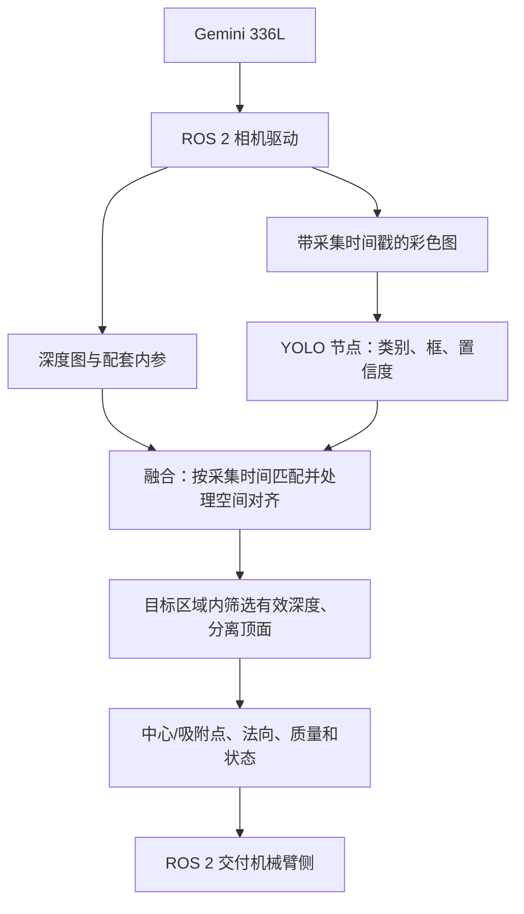

# 深度相机识别改进方案

> 更新日期：2026-10-27
> 文档类型：活文档，记录当前结论与后续改进路线。
> 设备：Orbbec Gemini 336L。
> 目标：识别需要抓取的物块，计算可靠的三维位置、顶面方向与质量信息，经 ROS 2 交付机械臂侧。
> 本文中的改进项是后续方案，不代表代码已经实现。当前实现与数据以源码、[进度记录](progress.md)和本地报告为准。

## 一、目标与职责边界

视觉侧负责回答三个问题：**要抓哪个物块、抓取点在哪里、顶面朝哪个方向。**

| 视觉侧负责 | 与机械臂侧共同确认 | 机械臂侧负责 |
|---|---|---|
| 图像采集、目标识别、深度融合 | 数据坐标系、单位、法向方向 | 运动规划、逆运动学与执行 |
| 顶面提取、中心/吸附点与法向估计 | 相机到基座变换由谁提供和执行 | 接近、下降、吸取和撤离动作 |
| 质量判定、精度测试、结果发布 | 消息接口、更新频率和有效期 | 机械臂运动中的碰撞检查 |
| 无效、歧义与过期状态的表达 | 吸盘直径、可容忍定位及角度误差 | 吸盘动作与吸取成功检测 |

第一版继续提供明确标注的相机光学系结果，不因为机械臂需要基座系就直接修改 `frame_id`。若约定交付基座系，必须先取得有效变换并实际转换位置和法向。

本阶段不要求视觉侧实现机械臂控制，也不以机械臂吸起成功代替视觉定位精度测试。

## 二、当前算法如何工作

现有方法是纯深度几何检测，不依赖彩色图或 YOLO。

```text
深度图 + 深度内参
        ↓
反投影为三维点云，裁剪 ROI、降采样
        ↓
寻找桌面平面，去掉桌面点
        ↓
根据深度跳变，把剩余区域分成候选物体
        ↓
取各候选中离桌面最远的约 20% 点，拟合顶面
        ↓
计算顶面点云重心、顶面法向和可吸性分数
        ↓
ROS 2 发布目标与可视化
```

通俗地说：先找到桌面，再找桌面上凸起的东西，最后从每个候选里找最上面的面。

- **点云**：每个深度像素结合内参得到一个三维点，很多点拼出可见表面。
- **桌面拟合**：RANSAC 反复尝试平面，寻找得到较多点支持的平面；实际场景中它不一定总能选对桌面。
- **顶面中心**：目前是所选可见顶面点的平均位置；遮挡和不均匀缺深度会使它偏离完整顶面的几何中心。
- **法向**：垂直于拟合顶面的单位向量，统一朝相机一侧。
- **可吸性**：根据局部点数、平整度、倾斜、深度空洞和簇点数打分，取最弱项；它是几何质量指标，尚不是实际吸取成功概率。

算法内部坐标单位毫米，ROS 输出位置单位米。原始深度光学系为 X 向右、Y 向下、Z 向前。深度 Z 是沿光轴的分量，不是相机到点的斜距。

## 三、已完成的工作与实测结论

### 3.1 本次已经完成的工程改进

| 已完成事项 | 实际作用 |
|---|---|
| ROS 输出沿用图像光学坐标系与采集时间戳 | 修正光学坐标被直接标成 `camera_link` 的问题；不一致时拒绝发布 |
| 修正位置中位数实际算成均值的问题 | 使统计名称与计算一致 |
| 新增全帧分析、候选状态和异常帧记录 | 能看到输出间断、歧义与跳变，而非只看一张成功截图 |
| 新增深度图、顶面局部、点云和稳定性图 | 帮助核对选面、位置和方向 |
| 保存 `meta.yaml` 参考值、CSV 与 JSON | 测量条件和结果可追溯，未知真值不当作通过 |

**这些改进主要提高了坐标表达和验证能力；没有重新设计原来的物块聚类、顶面提取和中心计算算法。** 进度文档中更早的“顶面重心沿法向错误挪动”修复，是本次接手前已有的工作。

### 3.2 三段真实 bag 的结论

下表统一采用默认 `SuctionParams`、固定随机种子 0、离线候选阈值 score ≥0.5。所谓“唯一合格候选”，只是满足当前规则，不代表已被独立标注证实识别正确。

| 数据 | 全段结果 | 可以说明什么 | 不能说明什么 |
|---|---|---|---|
| raw_003，372 帧 | 371 帧唯一合格候选，1 帧无合格候选；有效帧最大轴标准差约 1.01 mm | 该场景中输出连续性和重复性较好 | 不能说明绝对位置误差只有 1.01 mm |
| raw_002，360 帧 | 214 帧唯一合格候选，146 帧无合格候选；有效帧最大轴标准差约 1.42 mm | 当前阈值下输出间断较多，需分析分数限制项 | 缺独立标注，不能把输出比例当准确率或把未输出全部认作漏检 |
| raw_001，1037 帧 | 元数据记录无目标；789 帧出现合格候选，其中 153 帧唯一、636 帧多个 | 暴露了候选筛选和适用场景约束的不足 | 首、中、末帧变化明显，不能当固定空场景的误检率，候选坐标也不是物块位姿 |

raw_003 的历史尺测参考为 205 mm 立方体、相机倾角 60°，测量基准和不确定度未完整记录。前 60 帧深度时间中位数图的结果为：

| 项目 | 估计结果 | 参考与结论 |
|---|---|---|
| 顶面中心 | `[119.69, -15.07, 512.71] mm` | 没有独立 XYZ 真值，绝对精度未验证 |
| 顶面法向 | `[-0.0702, -0.8898, -0.4508]` | 表示相机系朝向；没有独立绝对法向真值 |
| 盒高 | 207.4 mm | 比尺测高 2.4 mm，超过原定 ±2 mm 容差 |
| 相机倾角 | 63.8° | 比水平仪参考大 3.8°，超过 ±3°；机身与光轴基准差待核查 |
| 顶面尺寸 | 214.9 × 210.5 mm | 按原有边缘损失公式，容差 12.5 mm，此项通过 |
| 顶面与桌面夹角 | 0.7° | 平行关系检查通过；不等于绝对姿态精度通过 |

raw_003 的逐帧位置分量中位数为 `[114.98, -13.10, 510.79] mm`。它与“先对深度图取时间中位数、再检测”的结果不同；报告必须保留两个名称，不能混用。

**总体评价：已经具备单个纸箱的定位原型，但尚未完成可可靠交付的识别、绝对精度和实时性验收。** 合成位置误差中位数 3.86 mm 是已有合成基线，不代替真实数据验收。

## 四、2D 是否需要 YOLO，ROS 2 与 GPU 如何分工

### 4.1 YOLO 的适用条件

| 场景 | 建议 |
|---|---|
| 固定区域只有一个已知物块 | 可先保留纯深度方案作基线 |
| 只需区分明显颜色 | 可先测试颜色分割 |
| 从杂物中识别指定类别 | 使用 YOLO 检测框辅助选目标 |
| 多物块相邻或遮挡，框中混入其他物体 | 在实际数据证明必要后引入实例分割 |

本项目建议第一版接入 2D 侧的目标框，用深度算法继续完成顶面定位；实例分割作为后续增强。模型需要在真实物块、背景和光照上验证，不能假定通用预训练模型或现有合成数据模型已经适用。

YOLO 普通检测输出类别、目标框和识别置信度；实例分割额外输出逐物体轮廓。它们都不能直接替代三维顶面拟合。

### 4.2 部署位置与计算设备

- Gemini 336L 负责采集彩色与深度数据；本方案中 YOLO 在连接相机的电脑上运行。
- ROS 2 负责节点组织、图像和结果传输。
- CPU 或 GPU 负责执行推理，两者与“是否使用 ROS 2”不是互斥选项。
- 当前仓库 YOLO 是 ONNX + OpenCV DNN，只支持 CPU；GPU 容器配置是预留，打开 GPU 透传不会让当前检测器自动使用 GPU。
- 先使用 CPU 跑通融合并测量端到端延迟；预算不足时再将 YOLO 后端切换到经过验证的 GPU 实现。训练/微调和运行时推理分开管理。

## 五、推荐的彩色与深度融合流程



### 5.1 时间同步：必须对应同一次拍摄

2D 检测结果保留输入彩色图的采集时间戳，不用“推理结束时间”替代。融合端依据该时间配对对应深度帧。即使 YOLO 处理慢，也不能拿旧框匹配最新深度。

第一版可按深度帧节流匹配 YOLO 的处理能力，缓存有界；找不到匹配帧就输出未匹配状态。同步容差、结果有效期和处理频率应依据实测时间戳与接收侧要求设置，不能通过堆积旧帧提高表面输出频率。

### 5.2 空间对齐：不能只把两张图缩放到同样大小

第一版优先验证 Orbbec 官方的 D2C，即把深度变换到彩色图像坐标下，使彩色框能对应到深度像素。实际可用模式和参数以已安装驱动版本为准。

对齐后必须使用与对齐图像配套的内参、畸变/校正状态和光学坐标系。不能沿用原始深度内参或将彩色光学系结果继续标成深度光学系；后续坐标变换也须使用对应光学系。

对齐检查使用实物边界的叠加图，覆盖画面中心、边缘和不同距离；同样的分辨率并不能证明几何对齐正确。物体边缘和遮挡区仍可能存在没有有效深度的像素，不能随意补成可靠接触面。

### 5.3 目标区域内进行三维定位

1. 过滤不需要的类别，保留符合要求的目标框。
2. 将框还原到原始彩色图像像素坐标，正确撤销 YOLO 缩放和补边。
3. 在对齐深度的对应区域取有效点，排除桌面、侧面、其他物体与飞点。
4. 拟合顶面，计算三维位置和法向，再检查吸盘接触区域。
5. 多候选、有效深度不足或拟合质量差时，输出明确的无效/歧义状态。

**不要直接采用“目标框中心 + 该像素深度”作为吸附点。** 框中心可能落在侧面、背景或空洞上。

当前 `fuse_node` 的 `use_2d_dets` 参数只会提示未实现，真正的融合路径尚待开发。raw_002 和 raw_003 没有彩色图，能用于深度回归，不能用于验证 YOLO 与深度融合；需要新录同步 RGB-D 数据。

## 六、深度算法的改进优先级

| 优先级 | 问题 | 改进方向 | 验证方式 |
|---|---|---|---|
| P0 | 背景也成为候选 | 使用实际工作区、类别及合理高度范围；核对拟合平面是否为桌面 | 固定空场景、背景杂物及工作区边缘测试 |
| P0 | 实时与报告的筛选条件不同 | 将质量阈值与状态输出显式配置并记录 | 相同帧在离线和节点中得到相同候选判定 |
| P1 | 最高 20% 可能混入侧面 | 用高度、平面方向和连通性筛选候选平面；拟合后沿平面薄层重新取点 | 大倾角、高物块、顶面缺失数据对照 |
| P1 | 可见点重心可能偏离几何中心 | 完整矩形顶面拟合轮廓/矩形中心；遮挡时标记不确定性 | 已知尺寸、独立中心参考与逐侧遮挡测试 |
| P1 | 中心附近不一定放得下吸盘 | 在顶面平面内检查真实吸盘足迹，远离边缘和空洞 | 不同吸盘尺寸、倾角和缺深度测试 |
| P1 | 固定像素点数受距离影响 | 有效覆盖比例、平面残差与最少支持点联合判断 | 同一物块不同距离的评分与输出比例 |
| P2 | 单帧波动、候选切换 | 同目标关联后做短窗口确认与平滑，设置超时失效 | 静止、移动、移走和重新出现测试 |
| P2 | 相邻物块可能粘连 | 检查框内深度分离，必要时加入逐物体掩码 | 两物块靠近、接触及部分遮挡测试 |

具体要求：

- 当前实时 `min_score` 默认 0，离线报告使用 0.5；0.5 只是当前分析条件，不能未经真实数据验证就宣布为最终部署阈值。
- 逐帧保存评分限制项，弄清低分由平整度、空洞还是点数造成，尤其要分析 raw_002 的输出间断。
- 现有吸盘检查在图像中使用圆形窗口近似；大倾角下应按顶面三维平面中的实际接触圆盘判断。
- 保留原始有效深度比例。补洞可以用于显示，不能把插值点当作真实接触证据。
- 平滑前先确认是同一物体；物体消失后及时失效，不能继续发布旧点。
- 反光、透明物体缺失深度时，2D 识别成功也不足以给出可靠三维接触点。

还要明确两个不同目标：**完整顶面的几何中心**用于物块定位与精度测试，**适合吸盘接触的点**用于抓取。后者可能偏离几何中心；未来若引入独立吸附点，必须增加明确字段并更新契约，不能静默改变 `position_mm` 的含义。

## 七、对接接口与代码落点

### 7.1 2D 侧交付给融合端

第一版建议通过 `/detections_2d` 的 `vision_msgs/Detection2DArray` 传递原图坐标下的目标框、类别与置信度，header 使用输入图像采集时间及对应光学系。输入图像尺寸、颜色通道顺序与框边界约定必须一致。实例分割掩码的传输方式在确实需要时单独设计。

YOLO 可以包装成独立 ROS 2 节点，内部调用现有纯 Python 检测器；2D 核心算法本身仍不引入 ROS 依赖。若 2D 侧已有独立推理进程，也可增加消息发布适配器，但两侧必须使用同一图像来源和时间基准。

### 7.2 视觉侧交付给机械臂侧

继续以已有 `/grasp_targets`（`Detection3DArray`）和 `/grasp_markers` 为基础，以下语义在接入前写入接口文档：

| 信息 | 约定 |
|---|---|
| 采集时间与坐标系 | 原始采集时间；按实际计算使用深度或彩色光学系，不能仅改标签 |
| 三维位置 | 明确表示几何中心还是独立吸附点；算法毫米、ROS 米 |
| 法向/姿态 | 法向是朝向可接近一侧的单位向量；现有四元数局部 +Z 对准法向，工具接近轴由机械臂侧按约定解释 |
| 目标类别 | 融合后保留真实识别类别；当前 `class_id` 为 `suction`，需显式更新契约 |
| 目标编号 | 当前 `target_id` 由每帧排序生成，不是跨帧稳定身份；需要跟踪时再引入稳定编号 |
| 两类分数 | 识别置信度和几何可吸性分别表达，不能混成识别成功概率 |
| 状态与质量 | 有效、无目标、歧义、同步失败、深度不足、过期等；报告拟合残差与有效覆盖等诊断量 |

现有消息与 `GraspTarget` 未覆盖上述全部字段。新增质量/状态的消息映射需要单独明确，可配套状态消息；不能把当前字段当作已经实现，也不能以全零协方差暗示误差已知。

视觉侧无需生成运动轨迹。机械臂侧接收相机系数据时，负责按双方约定执行到基座系的变换；若改由视觉侧转换，须明确标定数据来源、方向与版本。

### 7.3 实现落点

- `vision/depth/`：纯深度/融合几何运算与类型；不导入 ROS，不读取 bag。
- `vision/yolo/`：2D 模型推理；功能包之间不直接互相导入。
- `ros2_ws/src/vision_depth/`：接收、同步缓存、调用算法和发布，避免把几何算法写进回调。
- `lab/`：回放、评估、参数对比与可视化；`tests/`：不依赖外部大数据的回归测试。

具体类型、函数签名、话题和字段变更登记到 [接口契约](../../docs/interface.md)，按[协作规范](../../../knowledge/docs/视觉组协作规范.md)评审后再合并。

## 八、精度测试与可视化验收

### 8.1 分清重复性、相对位移和绝对精度

| 指标 | 测什么 | 当前条件 |
|---|---|---|
| 单帧重复性 | 同一静止位置多次输出的散布 | 已有 bag 可以分析，但先检查静止与目标身份 |
| 相对位移误差 | 两个位置估计距离与尺测移动距离之差 | 固定相机、网格和直尺可做 |
| 相机系绝对位置误差 | 输出点与独立 XYZ 真值之差 | 当前缺独立光学坐标参考 |
| 法向重复性 | 同一平面的估计法向是否稳定 | 可以统计，但不是绝对角度误差 |
| 法向绝对/相对误差 | 与独立法向或实测倾角变化比较 | 需额外建立参考，桌面平行检查不能代替 |

尺测初测使用同一物块、同一朝向，在至少 10 个位置分别重新摆放 3 次，每次取静止 60 帧。网格可标称 50 mm，但计算必须使用实测间距。垫高、斜板等尺寸也实测并记录量具分度和不确定度。

没有桌面到相机的独立旋转参考时，优先比较三维位移长度与尺测距离；桌面网格 X/Y 不能直接当成相机 X/Y 真值。差分通过也不等于绝对位置 M2 通过。

### 8.2 验收标准

- 沿用原项目真实绝对位置误差中位数 <15 mm 的目标，但仅在具备独立相机系真值时判定；P95、最大误差和测量不确定度一并报告。
- 尺测初步相对位移目标为误差中位数 <15 mm，单独标为相对测试，不用于签署绝对 M2。
- 法向误差中位数 <5° 需要独立参考；顶面与桌面接近平行只说明相对关系。
- 静止同目标最大轴标准差初测目标 ≤3 mm，同时报告各轴标准差及 3σ，不能把标准差和 3σ 混用。
- 在新录、独立标注的预期工作场景中，漏检率目标 <5%；同时报告误检、歧义和条件化位置统计，不能只报告成功帧精度。
- 当前盒高 ±2 mm、倾角 ±3° 和顶面尺寸容差作为诊断基线保留。若后续修改，先给出新的测量不确定度或实际任务依据，不能为使旧数据通过而放宽。
- YOLO、对齐、几何计算分别记录耗时，再统计采集到发布的端到端延迟和结果年龄；不把相机 30 fps 当作融合输出频率，也不把 GPU 推理耗时当作整链耗时。

### 8.3 必须保留的图表与数据

沿用现有报告结构：`overview.png`、`top_detail.png`、`pointcloud.png`、`stability.png`、`checks.png`、首中末帧对照、`frames.csv` 与 `summary.json`。融合后增加彩色检测框、彩色/深度边界叠加，以及原始图、掩码、顶面和吸附足迹的对应展示。

点云图中：灰蓝是拟合桌面，橙色是候选物体，紫色是选层，绿色点和箭头是中心与法向，黑叉是光学原点；两个视角显示同一份点云。算法选点不是人工真值。图上按 Z≤1200 mm 等条件裁剪，仅用于显示，不能影响精度统计。

每段新 bag 同存 `meta.yaml`，记录真实物块、尺寸、位置、相机固定情况、内参/流配置、图像对齐、量具及不确定度。调参集与验收集分开；正式验收冻结参数，失败帧和异常帧保留。

## 九、实施顺序与阶段交付

| 阶段 | 工作 | 可检查的交付物 |
|---|---|---|
| 1. 固定基线与采集条件 | 确定工作区、相机固定方式和物块范围；检查当前低分限制项 | 基线参数、新采集清单、候选问题分类 |
| 2. 打通同步 RGB-D | 启用 336L 彩色与深度，核查驱动版本、D2C、内参与时间戳 | 中心/边缘/多距离对齐图、时间差统计、新 bag |
| 3. 接入 YOLO 框 | 使用 CPU 现有检测器或已验证的 2D 模型，增加消息适配与配对 | 同一目标框和三维点云的叠加结果；无目标和不同步状态 |
| 4. 改进几何与稳定性 | 顶面筛选、三维吸盘足迹、条件化评分和同目标确认 | 与同一基线数据的前后对比、异常样本、回归测试 |
| 5. 完成视觉接口验收 | 尺测网格实验、独立标注评估、接口收发和端到端延迟测试 | 精度报告、接口说明、可复现命令、接收侧验证结果 |

每阶段单独提交和评审。只在实测推理/延迟不满足双方约定时安排 GPU 后端；只在矩形框无法有效分离物体时安排实例分割。全程以视觉数据的可靠性作为验收对象。

## 十、依据与相关文档

- [当前深度进度](progress.md)：已实现能力、真实/合成测试及限制。
- [raw_003 验证说明](raw_003验证说明.md)：报告生成和复算方法。
- [深度模块说明](../README.md)：算法职责、依赖方向和文件归属。
- [ROS 2 与 YOLO 接入方案](../../../knowledge/docs/ROS2接入方案-深度相机与YOLO.md)：既有架构讨论；其中规划文件、运行环境和性能数字须对照当前源码复核，不能全部当作已落地事实。
- [Orbbec D2C/C2D 定义](https://orbbec.github.io/OrbbecSDK_ROS2/en/source/camera_devices/1_overview/orbbecsdk_overview.html)：对齐图像、内参与坐标系的含义。
- [Orbbec 同步与对齐示例](https://orbbec.github.io/OrbbecSDK_v2/examples/3.advanced.sync_align/)：同步与空间对齐的官方示例。
- [Ultralytics 目标检测](https://docs.ultralytics.com/tasks/detect/)与[实例分割](https://docs.ultralytics.com/tasks/segment/)：框和掩码各自的输出含义。
- [Ultralytics 推理设备说明](https://docs.ultralytics.com/modes/predict/#inference-arguments)：CPU/GPU 等推理设备的选择。
